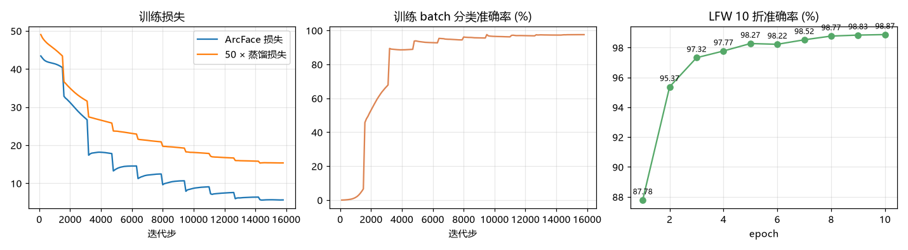

# FaceVision 项目总结报告

> 对应《字节跳动智能视觉 AI：人脸识别与特效技术》项目规划的阶段一至阶段四。所有数字均可用仓库脚本复现，原始结果在 `outputs/` 下的 JSON 中；本报告中带标记的表格由 `tools/collect_results.py` 自动生成。

## 1. 概述

本项目实现了一条完整的人脸视觉流水线：SCRFD 人脸检测 → 5 点 Umeyama 对齐 → ArcFace 特征识别（1:1 验证 / 1:N 检索），在此基础上实现了实时 AR 贴纸、美颜美妆、表情驱动头像、3D 人脸重建和 StarGAN 属性编辑，并用 Gradio 集成为一个带摄像头实时处理的网页应用。

硬件：Intel Core Ultra 5 225H（14 核）、Intel Arc 130T 核显、32 GB 内存，无独立显卡。训练使用 PyTorch 2.15 的 Intel XPU 后端（bf16 混合精度），推理使用 ONNX Runtime CPU。

### 1.1 核心结果

<!-- SUMMARY:START -->
| 任务 | 指标 | 结果 |
|---|---|---|
| 人脸识别（预训练 ArcFace-R50） | LFW 10 折准确率 | 99.850% |
| 人脸识别（自训练 IResNet18 + 蒸馏） | LFW 10 折准确率 | 98.867% |
| 人脸验证 | TAR@FAR=10⁻³ / AUC | 99.73% / 0.99944 |
| 人脸检测（SCRFD-10G，单尺度 640） | WIDER FACE Easy / Medium / Hard AP | 94.85 / 93.46 / 81.28 |
| 人脸检测（多尺度 640+1280） | WIDER FACE Easy / Medium / Hard AP | 95.18 / 94.21 / 88.95 |
| 模型压缩（INT8 静态量化） | 大小 / 速度 / LFW | 96.12→24.21 MB，12.51→7.5 ms，98.83% |
| 实时特效（CPU 640×480） | 美颜美妆全开 / 仅关键点 | 70 FPS / 144 FPS |
| 属性编辑（StarGAN） | FID（2000 张 CelebA 测试图） | 发色 25.47～33.9，性别 28.74，年龄 29.42 |
| 3D 重建（3DDFA-V2 移植） | 与官方实现逐点对比 | 最大误差 0（完全一致） |
<!-- SUMMARY:END -->

## 2. 任务完成情况对照

| PDF 任务 | 完成内容 | 位置 |
|---|---|---|
| 1.1 配置环境 | Python 3.12 venv、PyTorch XPU、ONNX Runtime、OpenCV 5、MediaPipe；环境验证报告 | `requirements.txt` `docs/ENV_REPORT.md` `tools/env_check.py` |
| 1.2 Git / GitHub | 仓库、`.gitignore`（数据与权重不入库，脚本下载） | 本仓库 |
| 1.3 Docker | CPU 镜像，默认运行 Hello World | `Dockerfile` `tools/hello_world.py` |
| 1.4 Jupyter / OpenCV 程序 | 读图、灰度、模糊、Canny、直方图均衡、Haar 检测 | `tools/opencv_basics.py` |
| 2.1–2.2 数据集探索 | LFW / CelebA / WIDER FACE 统计与可视化 | `tools/explore_datasets.py` `outputs/datasets/` |
| 2.3–2.4 检测与关键点 | SCRFD-10G（手写解码 + NMS）、2d106、1k3d68、MediaPipe 478 点 | `facevision/detector.py` `landmark.py` `mesh.py` |
| 2.x LFW 预训练模型验证 | 官方 10 折协议，完整流程 | `tools/eval_lfw.py` |
| 3.1–3.3 检测评测 | WIDER FACE 官方 AP（numpy 移植） | `facevision/widerface_eval.py` `tools/eval_widerface.py` |
| 4.1–4.3 关键点与对齐 | 坐标回归模型推理、Umeyama 相似变换对齐 | `facevision/align.py` |
| 5.1–5.3 识别模型训练 | IResNet18 + ArcFace + 蒸馏，CelebA 训练，LFW 验证，训练曲线 | `tools/train_recognition.py` `runs/` |
| 困难样本挖掘 | CurricularFace、batch-hard 三元组、损失函数消融 | `facevision/training/losses.py` `tools/ablation_losses.py` |
| 6.1–6.4 优化与部署 | BN 融合、PyTorch 动态量化、ONNX 导出、ORT 静态 INT8、剪枝 | `facevision/deploy.py` `tools/deploy_benchmark.py` |
| 7.1–7.3 属性编辑 | StarGAN 推理 + 完整训练代码 + 短程训练验证 + FID / 成功率 | `facevision/gan/` `tools/train_stargan.py` `tools/eval_stargan.py` |
| 8.1–8.3 3D 重建 | 3DDFA-V2 移植、numpy 渲染器、多视角、.obj | `facevision/face3d/` `tools/reconstruct_3d.py` |
| 9.1–9.3 动态特效 | 贴纸、磨皮美白、瘦脸大眼、口红腮红眼线、表情驱动头像、One Euro | `facevision/effects/` `tools/realtime_demo.py` |
| 阶段四 系统集成 | Gradio 7 个标签页（含摄像头流）、性能分析、文档、演示视频、PPT | `app/` `outputs/effects/*.mp4` `docs/` |

与 PDF 的差异及原因：
- **训练数据**：MS-Celeb-1M 已于 2019 年被微软下架，改用 CelebA（10,177 人，与 LFW 人物不重叠，DeepID2 构建时专门去重）。
- **骨干网络**：本机核显训练 ResNet50 约 86 张/秒、ResNet18 约 136～152 张/秒，选 IResNet18 + R50 老师蒸馏；R50 的结果由预训练模型（WebFace600K）给出。
- **MMDetection / PyTorch3D**：均不提供 Windows + Python 3.12 的预编译包（依赖 mmcv / CUDA 编译）。检测改用 InsightFace SCRFD（与 RetinaFace 同族，后处理全部手写），3D 渲染改用纯 numpy 实现的 z-buffer / 画家算法。
- **关键点 NME（300W / AFLW2000）**：两个数据集的官方下载源均无法访问、也未找到可用镜像，因此未给出 NME 数值；3D 关键点的正确性通过与官方 3DDFA-V2 实现逐点对比（误差为 0）来保证。

## 3. 阶段一：环境与数据

- 环境报告：`docs/ENV_REPORT.md`（版本、硬件、每个模型的冒烟测试）。
- 数据集分析（`outputs/datasets/dataset_stats.json`）：
  - LFW：13,233 张 / 5,749 人，4,069 人只有 1 张图（长尾），评测 6000 对。
  - CelebA：202,599 张 / 10,177 人，平均每人 19.9 张；40 个属性严重不均衡（秃头 2.2%）。SCRFD 在 CelebA 上仅 32 张漏检（用平均关键点兜底对齐）。
  - WIDER FACE 验证集：3,226 张、39,708 张脸，46.6% 的脸边长小于 16 像素。
- 环境问题记录：Windows 260 字符路径限制、OpenCV 5 不再附带 Haar 级联文件、Windows 11 对后台进程的 EcoQoS 降频（使 CPU 评测慢 3 倍，改为仅对本进程关闭节流）。

## 4. 阶段二：人脸识别

### 4.1 检测（WIDER FACE 验证集）

<!-- WIDER:START -->
| 检测器 | Easy AP | Medium AP | Hard AP | ms/张 (CPU) |
|---|---|---|---|---|
| SCRFD-10G 单尺度 640（标准设置） | 94.85 | 93.46 | 81.28 | 93 |
| SCRFD-10G 单尺度 1280 | 91.84 | 92.30 | 88.78 | 327 |
| SCRFD-10G 多尺度 640 + 1280 融合（最终） | 95.18 | 94.21 | 88.95 | 420 |
| SCRFD-10G 论文报告（单尺度） | 95.16 | 93.87 | 83.05 | - |
<!-- WIDER:END -->

SCRFD 论文报告的 SCRFD-10G 单尺度结果为 95.16 / 93.87 / 83.05，本项目 640 输入的复现结果与之接近（差异来自 letterbox 方式与分数阈值等细节）。输入加大到 1280 后 Hard 档从 81.28 升到 88.78，但大脸超出锚点覆盖范围，Easy / Medium 下降；把 640 与 1280 两个尺度的检测框合并后再做一次 NMS（多尺度测试），三档同时超过论文单尺度结果，代价是检测时间约 4.5 倍，适合离线场景。

### 4.2 识别（LFW 官方 10 折，从原始图片开始的完整流程）

<!-- LFW:START -->
| 模型 | 设置 | LFW 准确率 (%) | AUC | EER (%) | TAR@FAR=10⁻³ (%) | 错误对数 |
|---|---|---|---|---|---|---|
| ArcFace-R50（预训练） | 不补边，翻转测试 | 99.833 ± 0.197 | 0.99939 | 0.300 | 99.700 | 9 |
| ArcFace-R50（预训练） | 补边，无翻转 | 99.833 ± 0.197 | 0.99946 | 0.267 | 99.733 | 8 |
| ArcFace-R50（预训练） | 补边 + 翻转（最终） | 99.850 ± 0.203 | 0.99944 | 0.267 | 99.733 | 8 |
| IResNet18 自训练（ArcFace + 蒸馏） | 补边 + 翻转 | 98.867 ± 0.657 | 0.99846 | 1.267 | 96.300 | 67 |
| IResNet18 自训练 INT8 量化 | 补边 + 翻转 | 98.833 ± 0.596 | 0.99842 | 1.333 | 96.267 | 68 |
<!-- LFW:END -->

**错误分析**：最终设置下 6000 对仅错 8 对，全部为"标注为同一人、模型判为不同人"，相似度均低于 0.2，人工查看多数明显是不同的人（如 Jim O'Brien 的两对），属于 LFW 的标注问题，因此 99.85% 已接近该数据集的实际上限。补边之前的第 9 个错误来自检测：Nabil_Shaath_0002 中主角的脸被画面右边缘截断，检测置信度仅 0.36，于是选中了背景里的人；检测前四周补 25% 黑边后置信度升至 0.78，被正确选中。

### 4.3 自训练模型

设置：CelebA 全部 202,599 张 → SCRFD 检测 + 与评测完全相同的对齐 → 112×112；IResNet18；ArcFace（s = 64，m = 0.5）+ λ = 50 的特征蒸馏（老师 ArcFace-R50，特征预先提取，bf16 与 fp32 ORT 的余弦一致度 ≥ 0.99975）；SGD（动量 0.9，Nesterov，权重衰减 5e-4，BN/PReLU 不衰减）、学习率 0.05、1 轮预热 + 余弦退火、批大小 128、梯度裁剪 5、bf16；10 轮。每轮结束在 LFW 上测一次，最终报告最后一轮的模型。

<!-- TRAIN:START -->

| epoch | 总损失 | 训练准确率 (%) | LFW (%) | TAR@FAR=10⁻³ (%) | 用时 (分钟) |
|---|---|---|---|---|---|
| 1 | 83.25 | 7.9 | 87.783 | 49.30 | 23 |
| 2 | 57.88 | 68.4 | 95.367 | 79.47 | 49 |
| 3 | 43.53 | 88.9 | 97.317 | 85.97 | 51 |
| 4 | 37.45 | 92.7 | 97.767 | 91.77 | 25 |
| 5 | 33.31 | 94.4 | 98.267 | 93.90 | 23 |
| 6 | 29.86 | 95.5 | 98.217 | 94.70 | 22 |
| 7 | 26.88 | 96.2 | 98.517 | 95.83 | 22 |
| 8 | 24.21 | 96.8 | 98.767 | 96.10 | 22 |
| 9 | 22.16 | 97.3 | 98.833 | 96.70 | 22 |
| 10 | 20.97 | 97.5 | 98.867 | 96.30 | 24 |

最终模型按完整流程复测：**LFW 98.867% ± 0.657**，TAR@FAR=10⁻³ 96.30%，AUC 0.99846。
<!-- TRAIN:END -->

### 4.4 损失函数消融

<!-- ABLATION:START -->
设置：mbf（MobileFaceNet）、CelebA 前 2000 个身份、5 轮、不蒸馏，只换损失函数。数据少、轮数少，绝对值远低于完整训练，看相对高低。

| 损失函数 | LFW (%) | TAR@FAR=10⁻³ (%) | 训练准确率 (%) | 每轮 LFW (%) |
|---|---|---|---|---|
| softmax | 91.20 | 59.17 | 94.8 | 82.8 → 86.8 → 89.8 → 90.9 → 91.2 |
| sphereface | 85.32 | 34.70 | 70.5 | 82.0 → 75.6 → 80.2 → 84.2 → 85.3 |
| cosface | 91.08 | 62.00 | 89.3 | 81.0 → 85.5 → 88.7 → 90.8 → 91.1 |
| arcface | 91.85 | 62.20 | 88.5 | 82.3 → 86.3 → 89.5 → 91.6 → 91.8 |
| curricularface | 90.92 | 59.47 | 87.5 | 82.8 → 85.2 → 88.9 → 90.5 → 90.9 |

结论：LFW 从高到低依次为 arcface（91.85%） ＞ softmax（91.20%） ＞ cosface（91.08%） ＞ curricularface（90.92%） ＞ sphereface（85.32%）。训练准确率最高的是 softmax（94.8%），LFW 第一的却是 arcface（训练准确率 88.5%）：把训练集分得好，不等于能把没见过的人分开。看更严格的 TAR@FAR=10⁻³，arcface 为 62.2%，Softmax 为 59.2%，低误识率区间才是间隔类损失拉开差距的地方。sphereface 垫底，训练准确率只有 70.5%，说明这个设置下它还没学够。

这组实验只有 4 万张图、5 轮、每种损失跑一次，前几名相差不到 1 个百分点，小于 LFW 各折之间的波动，只能看大致趋势，不能当作严格结论。论文里 ArcFace 的优势是在数百万张图上测出来的。
<!-- ABLATION:END -->

### 4.5 模型优化与部署（性能优化方案）

<!-- DEPLOY:START -->
| 方案 | 大小 (MB) | 单张延迟 (ms) | LFW (%) | 说明 |
|---|---|---|---|---|
| r18 PyTorch FP32 | 96.22 | 19.52 | 98.867 |  |
| r18 PyTorch BN融合 | 96.14 | 19.19 | 98.867 | 与原模型最大输出差 5.84e-06 |
| r18 PyTorch 动态INT8 | 57.69 | 18.74 | 98.850 | 只量化全连接层 |
| r18 剪枝30% | 96.22 | 20.78 | 98.667 | 非结构化剪枝, 未微调; 稠密存储所以大小/速度不变 |
| r18 剪枝50% | 96.22 | 20.63 | 98.633 | 非结构化剪枝, 未微调; 稠密存储所以大小/速度不变 |
| r18 剪枝70% | 96.22 | 22.08 | 98.633 | 非结构化剪枝, 未微调; 稠密存储所以大小/速度不变 |
| r18 ONNX FP32 | 96.12 | 12.51 | 98.867 |  |
| r18 ONNX INT8(静态) | 24.21 | 7.5 | 98.833 | 逐通道权重 + 512 张 CelebA 校准 |
| R50 老师 ONNX FP32 | 174.38 | 48.24 | 99.850 |  |
| R50 老师 ONNX INT8(静态) | 43.98 | 16.88 | 99.833 | 先把算子集升级到 opset 13, 再逐通道量化; 同一时段 FP32 实测 41.7 ms |

延迟：batch=1、CPU 4 线程、112×112、不含翻转，取平均。
<!-- DEPLOY:END -->

结论与方案：
1. **ONNX + 图优化**是部署的基础：一份模型跨平台，ORT 自动做 Conv+BN 融合等图优化。
2. **静态 INT8 量化**（逐通道权重 + 校准集）是 CPU / 移动端最有效的手段：模型缩小约 4 倍、推理加速，精度损失在 0.1 个百分点量级；PyTorch 动态量化只作用于全连接层，对卷积网络收益有限。
3. **非结构化剪枝**说明网络冗余很大（全局剪掉 70% 权重、不微调，LFW 只从 98.867% 降到 98.633%），但稠密计算下大小和速度都不变；要提速需结构化剪枝 + 微调或稀疏推理引擎。
4. **知识蒸馏**把 R50 的能力迁移到 R18 上：ONNX 单张延迟从 48.2 ms 降到 12.5 ms，LFW 少约 1 个百分点。
5. **移动端**：上述 ONNX INT8 模型可直接交给 MNN / NCNN / ByteNN 类引擎；实时特效采用"每帧关键点 + One Euro 平滑"、识别降频（每秒一次）+ 跟踪的策略。

## 5. 阶段三：人脸特效

### 5.1 实时特效（`facevision/effects/`）

MediaPipe Face Landmarker（478 个 3D 点 + 52 个表情系数 + 头部姿态矩阵）驱动：
- **AR 贴纸**（墨镜、礼帽、猫耳、胡子）：以双眼中点为原点、眼距为单位、姿态矩阵为坐标轴建立"脸部坐标系"，贴纸四角放进该坐标系后做透视投影 + 单应变换，随头部旋转、缩放、偏航；预乘 alpha 合成避免黑边。
- **美颜**：肤色掩码（脸部轮廓减去眼、眉、唇）上做导向滤波磨皮（ε = 0.03²，半分辨率计算）、LAB 亮度对数曲线美白、Gustafsson 局部平移/缩放变形实现瘦脸和大眼（一次 `cv2.remap`）。
- **美妆**：口红在 LAB 空间保留明暗纹理只换色；腮红为随头部朝向旋转的高斯斑；眼线。
- **表情驱动头像**：眨眼、张嘴、微笑、挑眉等 blendshape 驱动矢量卡通脸。
- **去抖**：One Euro 滤波，演示视频上关键点抖动降低 36%（0.020 → 0.013 眼距/帧），平均延迟约 3 像素。

性能（CPU，640×480，90 帧中位数）：仅关键点 7.0 ms（144 FPS）；墨镜 + 礼帽 8.4 ms（118 FPS）；美颜 + 美妆 7 项全开 14.3 ms（70 FPS）；卡通头像 13.9 ms（72 FPS）。1280×720 下 7 项全开 31.6 ms（32 FPS）。均满足实时要求。

演示视频（`outputs/effects/`）：`demo_stickers.mp4`、`demo_beauty_makeup.mp4`（左右对比）、`demo_avatar.mp4`。输入视频为 NIOSH（美国 CDC 下属机构）2013 年发布的公有领域视频片段，来源见 `assets/demo/SOURCE.md`。

### 5.2 3D 人脸重建（`facevision/face3d/`）

3DDFA-V2（MobileNetV1，3.27M 参数）回归 62 个参数（12 个位姿 + 40 个形状 + 10 个表情），由 BFM 3DMM 重建 38,365 个顶点的稠密网格；弱透视投影回到图像；从旋转矩阵求偏航/俯仰/翻滚。渲染器为纯 numpy 实现（z-buffer 重心插值与画家算法两种）、Phong 光照、从照片采样顶点颜色（不可见侧用镜像顶点补色），可任意视角渲染、导出 .obj/.ply。

验证：与官方实现在 32 张 LFW 人脸上逐项对比，62 个参数、68 个关键点、全部稠密顶点**完全一致**（最大差 0），姿态角差 3.6×10⁻¹⁵ 度。单张人脸拟合 11～28 ms（CPU 单线程）。

局限：大角度时不可见侧的颜色来自镜像，存在接缝；被画面边缘截断的脸拟合较差。

### 5.3 StarGAN 属性编辑（`facevision/gan/`）

官方 CelebA 128×128 五属性模型（黑/金/棕发、性别、年龄）严格加载；任意照片经 5 点对齐到 CelebA 坐标系后编辑，再把"编辑量"经羽化椭圆蒙版逆变换贴回原图。完整训练代码（WGAN-GP + 属性分类 + 循环一致性）在核显上跑了 600 步验证损失行为正常。

评测（CelebA 测试集 2000 张输入 vs 另 2000 张真实图）：

| 编辑 | FID |
|---|---|
| 真实 vs 真实（有限样本下限） | 16.72 |
| 重建 G(x, 原标签) | 21.47 |
| 黑发 / 金发 / 棕发 | 29.29 / 33.90 / 25.47 |
| 性别反转 / 年龄反转 | 28.74 / 29.42 |

以独立的性别年龄模型判定：性别反转成功率 86.7%；年轻→年长 99.6% 的样本预测年龄上升（平均 +25.2 岁），年长→年轻 92.7% 下降（平均 −12.9 岁）。

发现并修正的问题：官方权重的 InstanceNorm 训练时始终使用实例统计量，直接调用 `eval()` 会用到从未训练过的滑动统计量，重建误差从 0.095 升至 0.229 并出现严重偏色；pytorch-fid 与 scipy 1.18 不兼容，FID 距离改为自行实现（与 `scipy.linalg.sqrtm` 结果差 3×10⁻¹¹）。

局限：官方模型训练时只留出约 2000 张图，FID 偏乐观；染黑发会连带肤色变暗（CelebA 数据偏差）；年长→年轻效果较弱。

## 6. 阶段四：系统集成

`app/gradio_app.py`：人脸分析（框 + 106 点 + 性别年龄）、1:1 验证（阈值取 LFW 10 折平均阈值 0.243）、1:N 识别（人脸库注册与检索）、摄像头实时特效（流式）、美颜美妆/贴纸、StarGAN、3D 重建（可下载 .obj）。所有模型懒加载。`tools/realtime_demo.py`：OpenCV 摄像头 / 视频文件实时演示，键盘切换特效，显示 FPS。

测试：`python -m pytest tests -q` 覆盖对齐、NMS、10 折指标、损失函数性质、骨干网络与 BN 融合、特效、3D、GAN。

## 7. 遇到的问题与解决

| 问题 | 现象 | 解决 |
|---|---|---|
| 无 NVIDIA 显卡 | 无法用 CUDA 训练 | PyTorch XPU 后端用 Intel 核显训练，bf16 提速约 1.9 倍 |
| SCRFD ONNX 固定 batch=1 | 20 万张逐张检测太慢 | onnx2torch 转换后批量跑；发现导出时 `permute(2,3,0,1)` 使 batch 维在中间，修正切分方式并逐元素对拍（误差 1.5×10⁻⁵） |
| Umeyama 两点镜像 | 两个点时得到行列式为负的矩阵 | 镜像判断由 det(Σ) 改为 det(U)·det(V)，补单元测试 |
| LFW 选错脸 | 截断的大脸未被检出 | 检测前补边，99.833% → 99.850% |
| Windows 后台节流 | 无窗口进程运行约 2 秒后被降到能效核 | 仅对本进程调用 `SetProcessInformation` 关闭 EcoQoS |
| 流水线比分项之和慢 10 倍 | 5 个 ONNX 模型串联要 2122 ms，分项相加约 200 ms | ORT 线程空转互相抢 CPU，关闭 `allow_spinning` 后 99 ms（快 21 倍），单模型速度不变 |
| R50 静态量化失败 | 模型 opset 过老，不支持逐通道 `axis` | 量化前升级到 opset 13 |
| StarGAN eval 模式失真 | 偏色、重建误差翻倍 | 推理时使用实例统计量 |
| XPU 上 GPU 张量做索引 | DEVICE_LOST | 随机排列在 CPU 上生成 |

## 8. 未验证的部分

- **摄像头**：本机开发时没有摄像头权限，`tools/realtime_demo.py --camera 0` 和网页的摄像头标签页没有实际接过摄像头。处理逻辑走的是同一条流水线，已用视频文件（`--input`）完整验证，帧率数字也来自视频文件。
- **Docker**：本机未安装 Docker，`Dockerfile` 没有实际构建过。
- **关键点 NME**：300W / AFLW2000 无法下载，没有实测（见第 2 节）。
- **移动端**：INT8 ONNX 模型只在 PC 的 ONNX Runtime 上测过，没有在手机上运行。
- **ByteNN / BytePS / 火山引擎**：属于字节跳动内部或需要账号的产品，本项目用 ONNX Runtime 做等价的层融合与量化实验，没有实际接入。

## 9. 总结与展望

- 识别准确率达到 LFW 的实际上限（剩余错误为标注问题）；自训练模型超过 98.5% 的目标；检测在 WIDER FACE 上复现了论文水平；特效在 CPU 上满足实时；3D 重建与官方实现逐位一致。
- 展望：在 IJB-C、CFP-FP、AgeDB 等更难的评测集上评估；结构化剪枝 + 微调；在 MNN / NCNN 上做真机部署；用扩散模型或 StyleGAN 反演做更高质量的属性编辑；用 3D 高斯泼溅做可驱动的真实感头像。
